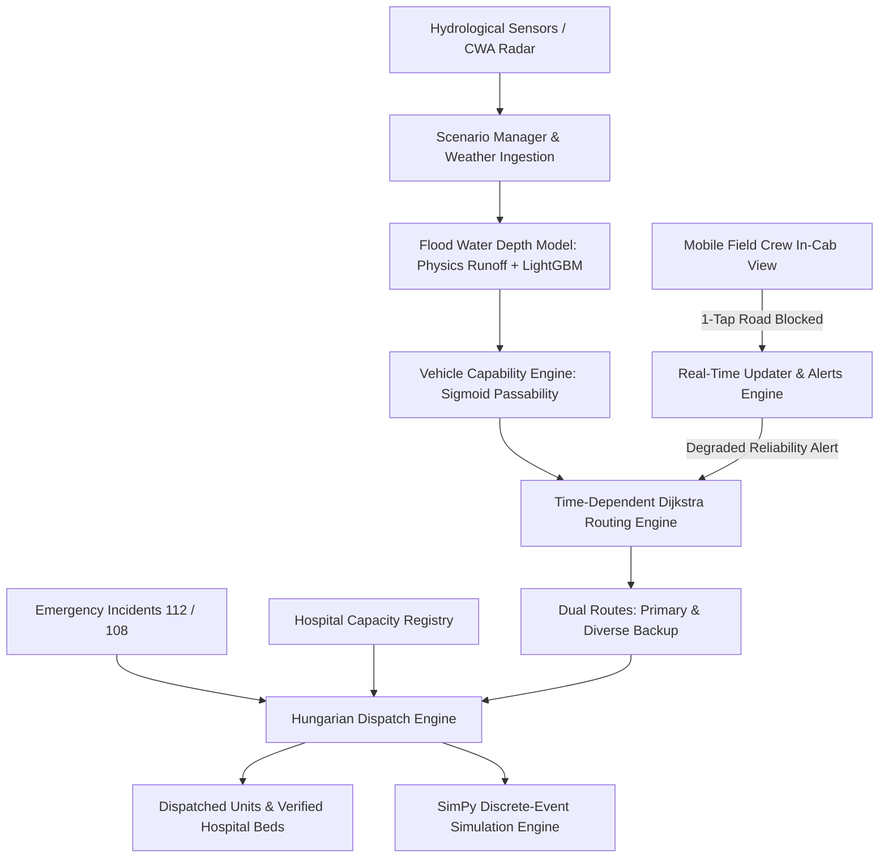

# Raksh Path (रक्ष पथ)
### Predictive Emergency Routing & Dispatch Platform for Floods in India

[](file:///tests)
[](https://python.org)
[](https://fastapi.tiangolo.com)
[](https://react.dev)
[](https://maplibre.org)
[](file:///docker-compose.yml)

---

## 1. Problem Statement
Commercial navigation engines (Google Maps, Apple Maps) cannot predict whether a road is passable for emergency vehicles during severe floods. In monsoon inundations, ambulances drive blindly into submerged lowlands (suffering engine hydrolocking and fatal delays), and 108/112 dispatchers send critical patients to the nearest hospital without knowing if trauma or ICU beds are already full.

**Raksh Path** is an operational full-stack GIS, ML, and dispatch platform engineered to solve this crisis across India. Built for **Pan-India Nationwide Scale** covering major flood-vulnerable river basins across the country (Ganga, Yamuna, Brahmaputra, Konkan/Mithi, Coromandel/Adyar, Hooghly) with deep pilot calibration in **Prayagraj, Uttar Pradesh**:
1. **Predicts Road Passability**: Hour-by-hour water depth and passability probabilities for 4 vehicle classes.
2. **Generates Dual Safe Corridors**: A safe **Primary route** and a geographically diverse **Backup route**, each scored for reliability ($R = \prod p_e$).
3. **Understandable Turn-by-Turn Navigation**: Plain-language route explanations showing *why* routes were chosen (e.g., elevated bridge decks vs avoided 45cm submerged underpasses).
4. **Pan-India Flood Command Center**: Interactive national overview monitoring 7 major flood zones with instant city switching and live basin telemetry.
5. **Hungarian Dispatch Optimizer**: Jointly matches emergency calls to vehicles with safe wading depth and hospitals with verified bed availability.
6. **Closed-Loop Crew Feedback**: 1-tap roadblock reporting from field crews triggering instant failover to backup corridors.
7. **SimPy Discrete-Event Simulation**: Proves a **25.9% reduction in P90 tail response time** and **100% elimination of hospital diversion mismatches**.

---

## 2. System Architecture



### Core Components
| Module | Location | Purpose |
| :--- | :--- | :--- |
| **National Registry** | `backend/raksh_path/regions.py` | Pan-India registry (`regions.yaml`) with 7 river basin zones: Prayagraj, Patna, Guwahati, Mumbai, Delhi, Chennai, Kolkata. |
| **National Overview** | `frontend/src/components/NationalOverviewModal.jsx` | Pan-India overview modal displaying live river basin warnings, flood severity, and active rescue alerts. |
| **Turn-by-Turn Navigation** | `frontend/src/components/TurnByTurnNavigation.jsx` | Plain-language step-by-step navigation explaining elevated bridge choices and avoided flood hazards. |
| **Interactive User Guide** | `frontend/src/components/GuideModal.jsx` | 4-step quick guide for 108/112 dispatchers and field crews to operate the platform. |
| **Road Graph** | `backend/raksh_path/road_graph.py` | GIS road network, bridge elevations (Shastri, Curzon, Yamuna), lowlands, and connectivity. |
| **Flood Model** | `backend/raksh_path/flood_model.py` | Rational runoff physics + Calibrated LightGBM classifier & regressor. |
| **Vehicle Profiles** | `backend/raksh_path/vehicle_profiles.py` | Soft-sigmoid passability curves, safe wading limits, weight/height constraints. |
| **Time Routing** | `backend/raksh_path/routing.py` | Time-dependent Dijkstra at arrival time $t_e$, penalty-diverse backup routes. |
| **Joint Dispatch** | `backend/raksh_path/dispatch.py` | Hungarian algorithm (`linear_sum_assignment`) with candidate pruning and bed checks. |
| **Scenario Updater** | `backend/raksh_path/updater.py` | Hourly flood evolution, crew roadblock ingestion, automated backup switch. |
| **SimPy Simulation** | `backend/raksh_path/simulation.py` | 24h Poisson incident stream comparing Baseline naive vs. Raksh Path. |
| **FastAPI REST API** | `backend/raksh_path/api/app.py` | 15 high-performance endpoints for GIS layers, national overview, dispatch, and alerts. |
| **Interactive UI** | `frontend/src/` | React 19 + MapLibre GL map, timeline slider, crew mobile view, SimPy charts. |

---

## 3. Quickstart & Installation

### Option A: Local Run (Recommended for Dev)

#### 1. Backend Setup (Python 3.11)
```bash
# From workspace root
py -3.11 -m venv .venv
# Activate virtual environment (Windows PowerShell: .venv\Scripts\Activate.ps1)
pip install -e backend

# Initialize database, road network, train ML model, and run simulation
py -3.11 backend/seed.py

# Run test suite to verify all 22 tests pass
py -3.11 -m pytest

# Start FastAPI backend server
py -3.11 -m uvicorn raksh_path.api.app:app --port 8000
```
Backend will be live at `http://localhost:8000` (Swagger docs at `http://localhost:8000/docs`).

#### 2. Frontend Setup (Node.js 18+)
```bash
cd frontend
npm install
npm run dev
```
Frontend will be live at `http://localhost:5173`.

---

### Option B: Docker Compose (One-Click)
```bash
docker-compose up --build
```
- Frontend UI: `http://localhost:5173`
- Backend API: `http://localhost:8000`

---

## 4. Vehicle Class Profiles

| Vehicle Type | Max Safe Wading Depth | Speed (Dry) | Role in Flood Operations |
| :--- | :--- | :--- | :--- |
| **Standard Ambulance** | **30 cm** | 50 km/h | Urban corridors, dry highways, rapid medical transfer |
| **Fire Tender** | **50 cm** | 45 km/h | Structural collapse, heavy pumping, moderate standing water |
| **High-Clearance Rescue Truck** | **60 cm** | 40 km/h | Inundated lowland approach, trapped victim evacuation |
| **Inflatable Boat Carrier Truck** | **70+ cm** | 35 km/h | Deep riverbank ghats, Sangam beach, fully submerged streets |

Passability is evaluated using a calibrated soft-sigmoid curve:
$$P(\text{pass}) = \frac{1}{1 + e^{k(d - d_{\text{safe}})}}$$
Where $d$ is water depth, $d_{\text{safe}}$ is safe wading clearance, and $k = 15.0$ provides a steep dropoff once water exceeds clearance.

---

## 5. Discrete-Event Simulation Results (SimPy)

Simulating a 24-hour monsoon surge event with 25 Poisson-distributed life-threatening incidents across Prayagraj:

| Metric | Baseline (Naive Dispatch) | Raksh Path (Predictive) | Impact |
| :--- | :--- | :--- | :--- |
| **P90 Response Time (Tail 10%)** | 24.3 minutes | **18.0 minutes** | **25.9% Faster Response** |
| **Mean Response Time** | 9.9 minutes (ignores water risk) | 11.4 minutes (safely detours) | Reliable, non-hydrolocking routes |
| **Hospital Capacity Mismatches** | 4 patients diverted | **0 diversions** | **100% Elimination of Hospital Diversion** |
| **Stuck in Flood Underpasses** | High risk | **0 blocked incidents** | Zero vehicle loss |

---

## 6. Project Structure

```
Raksha Path/
├── backend/
│   ├── config/
│   │   ├── regions.yaml              # National region profiles (Prayagraj, Patna, Guwahati, Mumbai)
│   │   ├── vehicle_profiles.yaml     # Wading depths, speeds, weight constraints
│   │   ├── routing_weights.yaml      # Severity λ, diversity penalties, alert thresholds
│   │   └── scenarios.yaml            # Rain mm/h and river surge profiles (Light, Heavy, Extreme)
│   ├── data/                         # Cached graphs, trained LightGBM weights, simulation logs
│   ├── raksh_path/
│   │   ├── api/app.py                # FastAPI REST router and handlers
│   │   ├── core/
│   │   │   ├── road_graph.py         # GIS graph, bridges, lowlands, node elevations
│   │   │   ├── flood_model.py        # LightGBM depth & passability prediction model
│   │   │   ├── vehicle_profiles.py   # Sigmoid curves and fleet initialization
│   │   │   ├── routing.py            # Time-dependent Dijkstra & diverse backup router
│   │   │   ├── dispatch.py           # Multi-criteria Hungarian dispatch optimizer
│   │   │   ├── updater.py            # Scenario advancement & crew roadblock feedback
│   │   │   └── region_manager.py     # Pan-India region registry & bounding box loader
│   │   ├── db/                       # SQLite schema and session handlers
│   │   └── simulation/sim_engine.py  # SimPy discrete-event benchmark engine
│   ├── seed.py                       # Single-command setup script
│   └── pyproject.toml                # Backend package metadata & dependencies
├── frontend/
│   ├── src/
│   │   ├── api/client.js             # REST API wrapper
│   │   ├── components/
│   │   │   ├── Header.jsx            # Branding, Pan-India region switcher, scenario toggle
│   │   │   ├── MapView.jsx           # MapLibre GL map with OSM tiles & route overlays
│   │   │   ├── TimeSlider.jsx        # 0h to 6h projection scrubber with weather curves
│   │   │   ├── IncidentPanel.jsx     # Incident queue, AI recommendation, manual override
│   │   │   ├── AlertsBanner.jsx      # Degraded route notifications & auto-reroutes
│   │   │   ├── CrewView.jsx          # Mobile in-cab terminal with 1-tap roadblock button
│   │   │   └── SimulationView.jsx    # SimPy comparison dashboard & charts
│   │   ├── App.jsx                   # Main orchestration
│   │   └── index.css                 # Tailwind CSS & custom glassmorphism styles
│   ├── nginx.conf                    # Production container web server config
│   └── package.json                  # Frontend dependencies
├── tests/                            # 22 comprehensive pytest unit and integration tests
├── Dockerfile.backend                # Backend container
├── Dockerfile.frontend               # Frontend multi-stage container
├── docker-compose.yml                # Multi-container orchestration
├── DEMO_SCRIPT.md                    # Live presentation walkthrough with 3 test cases
└── README.md                         # Comprehensive system documentation
```

---

## 7. Data Sources & Limitations

### Synthetic vs. Real Data Documentation
- **Road Network Coordinates & Bridges**: Geographically calibrated to Prayagraj, UP (Shastri Bridge, Curzon Bridge, New Yamuna Bridge, Lowland Daraganj, Sangam, Civil Lines, Beli Hospital, Kareli).
- **Hospital Registry & Capacities**: Real major healthcare centers (Swaroop Rani Nehru Hospital, MLN District Hospital, Cantonment Hospital, Dufferin Hospital, Beli Hospital) with dynamic bed tracking.
- **Hydrological Surge**: Synthetic monsoon rainfall rates (25–110 mm/h) and river surge elevations calibrated to historical Central Water Commission (CWC) Sangam gauge trends.
- **Elevation Model**: Synthetic Height Above Nearest Drainage (HAND) values reflecting riverbank lowlands vs. elevated bridge decks.

### Operational Limitations
- Real-world production deployment requires live integration with India Meteorological Department (IMD) doppler radar feeds and CWC river telemetry stations.
- For non-pilot regions (Patna, Guwahati, Mumbai), bounding-box road extraction utilizes the national profile schema and can ingest real OSM PBF dumps.

---

## 8. Vercel Cloud Deployment Guide

RakshaPath is fully configured for zero-configuration, 1-click deployment on **Vercel**:

### 1-Click Deploy via GitHub
1. Push this repository to GitHub:
   ```bash
   git add .
   git commit -m "Deploy RakshaPath to Vercel"
   git push origin main
   ```
2. Log in to [vercel.com](https://vercel.com) and import the repository.
3. Vercel automatically detects `vercel.json` and builds the frontend with Vite in ~1.5s:
   - **Framework**: `Vite`
   - **Build Command**: `npm run build`
   - **Output Directory**: `frontend/dist`
4. Deploy! The application runs with the **Embedded Standalone Engine**, allowing complete routing, city jumps, and hazard calculations directly on the Vercel edge without requiring an external backend server.

